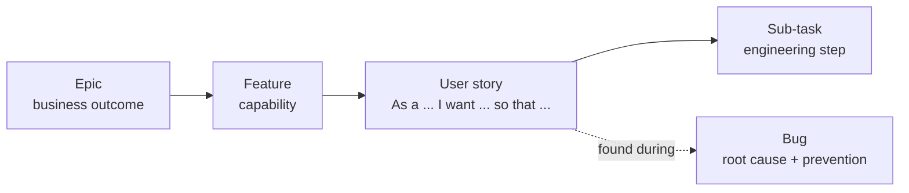

# Project management view

How the case-study platform behind this skill was planned and delivered, as a product backlog: epics, features, user stories, sub-tasks and bugs.

The platform went from a static launch site to a full learning and careers platform (accounts, dashboards, learning portal, payments, job board, support, blog) in **8 days and 118 commits** (Nov 5 to 12, 2026), with Claude doing most of the engineering and a product owner setting scope, priorities and release gates.

| | Count |
|---|---|
| Epics | 14 |
| Features | 24 |
| User stories | 65 |
| Sub-tasks | 176 |
| Bugs found and fixed | 38 |
| Automated checks passing before release | 1,298 |

## Files

| File | What it is |
|---|---|
| [BACKLOG.md](BACKLOG.md) | Every epic, feature and story with acceptance criteria, sub-tasks and the bugs found under it |
| [BUGS.md](BUGS.md) | Bug log: severity, type, who found it, root cause, fix and what now prevents it |
| [backlog.csv](backlog.csv) | The same backlog as a CSV you can import into Jira (or Linear, Azure Boards, GitHub Projects) |

## Hierarchy

Each story has acceptance criteria written as checks, so "done" means the criteria pass, not that code exists.

## Delivery timeline

| Day | Milestone | Epics |
|---|---|---|
| Nov 5 | Launch site live: 9 pages, lead capture | E01 |
| Nov 6 | Design system, SEO and AI-engine readiness, pen test and hardening, move to Cloudflare, learning platform foundation, sign in | E02, E03, E04, E05, E06, E12 |
| Nov 7 | Checkout, tax and local currency, certificates, roles, notifications, help and support, portal dark theme | E05, E06, E07, E09 |
| Nov 9 | Responsive audit (16 screen sizes), job board, search, insights dashboard | E08, E09, E11 |
| Nov 10 | Career profiles, applicant tracking, consent and policies, evaluation kit, two-step sign in, recordings on free storage | E05, E06, E08, E10, E11 |
| Nov 11 | Performance round, two security audits, retention and data export, blog with approval badges, wider sharing and exact-time publishing, account menu on public pages, zero-to-live skill | E05, E09, E10, E12, E13, E14 |
| Nov 12 | Sitemap leaves out noindex pages, a share image per article, richer blog articles (photos, walkthroughs, quick checks, checklists, site-drawn diagrams, branded covers), covers on shared link cards, blog result in the scheduled job log | E03, E09 |

## How the work was run

- **Definition of done before code.** Lighthouse targets, screen sizes and privacy rules were agreed per epic, then written as acceptance criteria.
- **Phase gates.** Launch site, then accounts, then money, then everything else. Each phase passed the full suite before the next started.
- **Batched releases.** Changes were held and deployed in batches against a monthly build budget, with the builds left stated before each deploy.
- **Tiered testing.** Quick checks on every change, the full suite once per batch. See [references/testing.md](../references/testing.md).
- **Every bug gets a guard.** A fix isn't closed until something (a test, a compliance rule, a runbook step) stops it recurring.

## Import into Jira

1. In Jira, go to **Settings, System, External system import, CSV** (or a project's **Import issues**).
2. Upload `backlog.csv` and map the columns: `Issue Id` to Issue Id, `Parent Id` to Parent, and the rest by name.
3. Sub-tasks attach to their story, and stories and bugs attach to their epic, through `Parent Id`.

## Notes on this reconstruction

The backlog was reconstructed after delivery from the commit history and build records, so it shows what was actually built rather than an up-front plan. Story points are deliberately omitted rather than invented. Customer data, vendor account details, credentials, pricing and the names of individuals are left out, and every bug listed here has been fixed.
